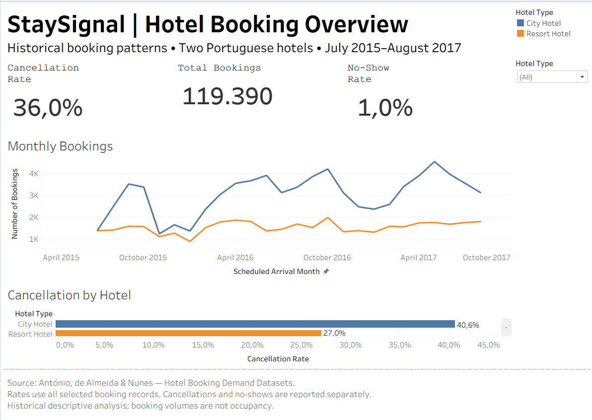
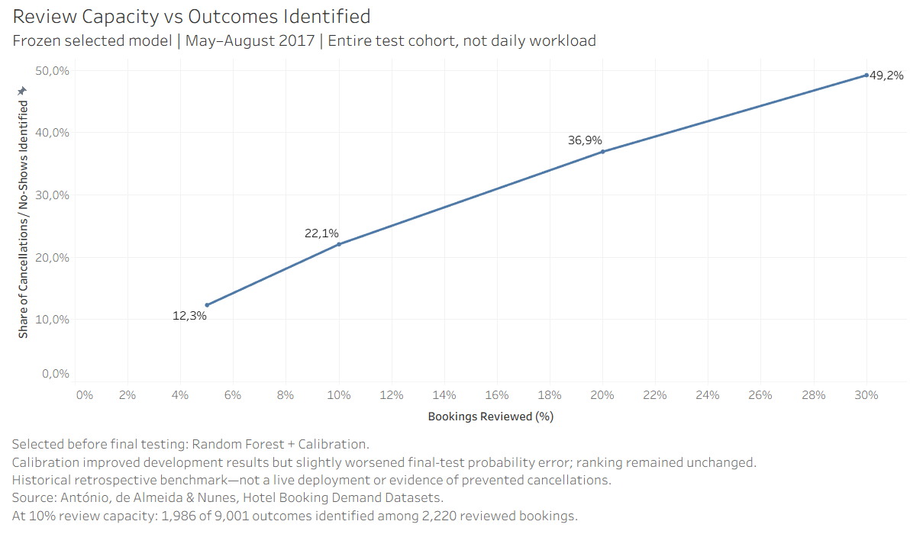
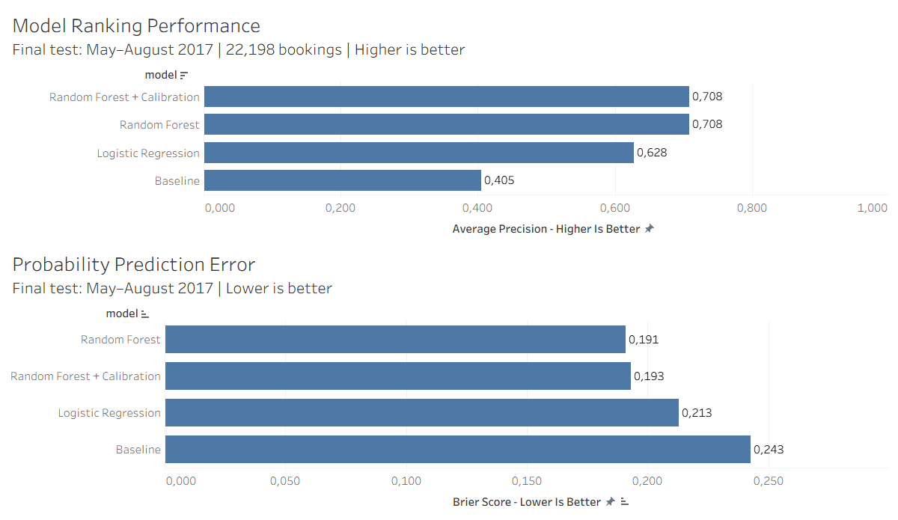

# StaySignal

Hotel booking analysis and cancellation-risk modelling with **Python, scikit-learn and Tableau**.

I built StaySignal to explore a practical hospitality question: if a team can review only a small share of bookings, can a model help prioritise which ones to look at?

The project uses **119,390 bookings from two Portuguese hotels**, covering July 2015 to August 2017.

## What I built

- A data preparation workflow that handles missing values, cleans text fields and flags unusual records.
- Logistic regression and random forest models for cancellations or no-shows, compared with a simple baseline.
- Evaluation on later arrival periods, with checks for outcome leakage, label availability and calibration.
- Tableau dashboards showing booking trends, model performance and review-capacity trade-offs.

**Tools:** Python 3.11, pandas, NumPy, scikit-learn, joblib, Matplotlib, seaborn and Tableau Public.

## Main result

On the final test set of **22,198 bookings**, the selected model's highest-risk 10% contained **1,986 cancellations or no-shows among 2,220 bookings reviewed**.

That is **89.46% precision**, identifying **22.06% of all outcomes** at that review capacity—about **2.21 times random selection**.

| Model | Average precision ↑ | ROC-AUC ↑ | Brier score ↓ |
|---|---:|---:|---:|
| Baseline | 0.4055 | 0.5000 | 0.2428 |
| Logistic regression | 0.6281 | 0.6984 | 0.2128 |
| Random forest | 0.7082 | 0.7564 | 0.1909 |
| Random forest + calibration | 0.7082 | 0.7564 | 0.1930 |

I selected the calibrated forest before final testing. Calibration helped during development but slightly worsened final-test probability error; I kept the original selection and reported both versions.

## Dashboards





<details>
<summary>Model comparison charts</summary>



</details>

Download the [Tableau workbook](dashboards/StaySignal.twbx) and open it in Tableau Public or a compatible Tableau Desktop version. The data extracts are included.

## Scope

This is a historical benchmark. The review queue covers the whole test cohort, and the results measure outcomes identified, not cancellations prevented or money saved. The data does not establish which fields were available at booking time, so live prediction would need a separate feature audit and validation on current hotel data.

The [feature audit](docs/feature_audit.md), [test findings](docs/final_test_findings.md) and [evaluation reports](reports/) contain the details. Python scripts are in [`src/staysignal/`](src/staysignal/).

## Python setup

From the repository root in Windows PowerShell:

```powershell
py -3.11 -m venv .venv
.\.venv\Scripts\Activate.ps1
python -m pip install -r requirements.txt
```

This sets up the Python environment. The Tableau workbook can be viewed without running the scripts. Raw data and trained Python models are excluded from Git.

## Data

António, de Almeida & Nunes (2019), [Hotel booking demand datasets](https://doi.org/10.1016/j.dib.2018.11.126).

The original `H1.csv` and `H2.csv` files are in the article's [supplementary materials](https://pmc.ncbi.nlm.nih.gov/articles/PMC6297060/), archive `mmc2.zip`. File fingerprints are recorded in the [source manifest](docs/data_source_manifest.json).
